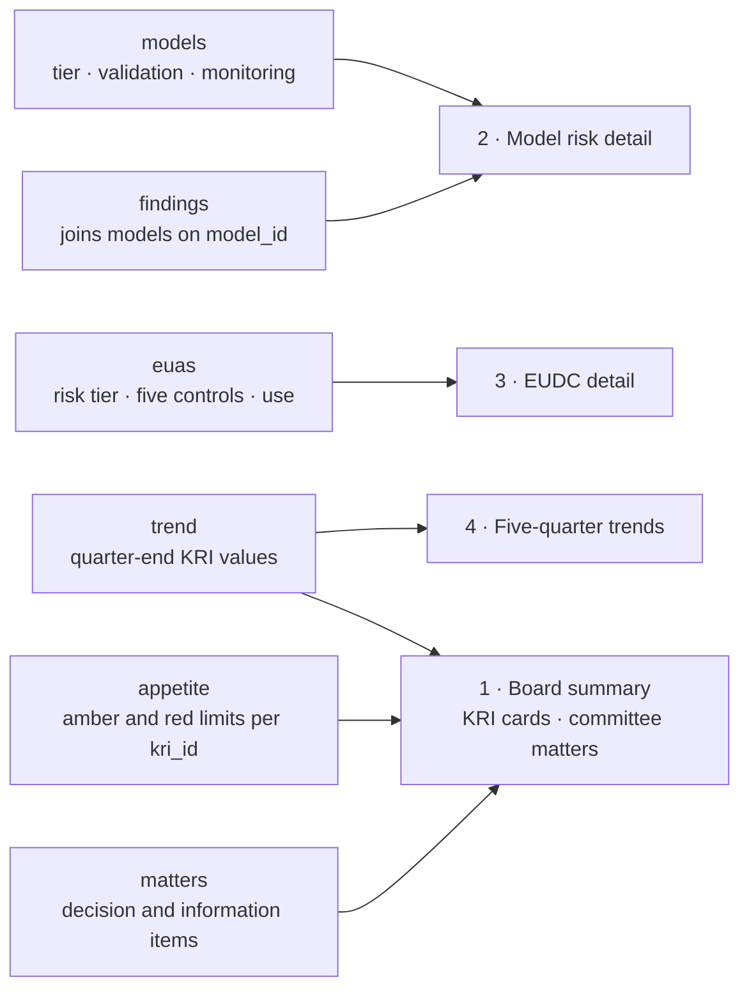

# MRM & EUDC Dashboard Build Specification

This specification lets a team rebuild a quarterly Model Risk and End-User Developed Computing (EUDC) dashboard for a Model Risk Management Committee (MRMC) and Board. It defines six source tables, the business rules, seven KRIs and the page layout. It contains no company data: all names, limits and examples are generic.

It supports three uses:

1. **Rebuild from the design.** Hand this document to a developer or an approved AI tool as the requirements.
2. **Rebuild in a BI tool.** The Power BI section maps the design to a data model and DAX measures; the same logic applies in Tableau or Excel.
3. **Use the template.** The standalone HTML dashboard in `dashboard/` implements this spec over the sample CSVs in `data/`.

## Data model



The Board summary needs only the trend, appetite and matters tables; the model and EUA inventories feed the MRMC detail. Findings join to models on `model_id`, and each appetite `kri_id` names a column in trend.

## Data dictionary

All six tables are flat extracts as of quarter end. Dates are ISO (YYYY-MM-DD); Y/N flags are text.

### models — one row per model in inventory

| Field | Type | Allowed values / notes |
| --- | --- | --- |
| model_id | Text, key | e.g. M01 |
| model_name | Text | |
| tier | Text | Mission Critical, Significant, Other |
| owner | Text | Owning business area |
| vendor | Y/N | Vendor model flag |
| last_validation | Date | Completion date of last full validation |
| next_validation_due | Date | last_validation + tier cycle (rule V1) |
| validation_status | Text | Current, Due within 90 days, Overdue (rule V2) |
| validation_rating | Text | Satisfactory, Needs improvement, Unsatisfactory |
| monitoring | Text | Green, Amber, Red (latest ongoing-monitoring result) |
| residual_risk | Text | Low, Moderate, High (rule R1) |

### findings — one row per open model finding

| Field | Type | Allowed values / notes |
| --- | --- | --- |
| finding_id | Text, key | e.g. F-001 |
| model_id | Text | Joins to models |
| model_name | Text | Denormalised for display |
| severity | Text | High, Medium, Low |
| source | Text | Validation, Internal Audit, FHFA examination, Ongoing monitoring |
| title | Text | One-line description |
| opened | Date | Date raised |
| due | Date | Agreed remediation date |
| days_open | Integer | As-of date − opened |
| days_past_due | Integer | max(0, as-of date − due) |
| status | Text | Open, Past due |

### euas — one row per end-user application

| Field | Type | Allowed values / notes |
| --- | --- | --- |
| eua_id | Text, key | e.g. EUA-0001 |
| business_unit | Text | Owning unit |
| type | Text | Excel workbook, Access database, Python script, SQL / BI report, R / SAS program |
| risk_tier | Text | High, Medium, Low |
| downstream_use | Text | Model input, Regulatory reporting, Financial reporting, Management reporting, Operational |
| access_control, change_control, version_control, documentation, independent_review | Y/N | One column per control |
| last_review | Date | Last periodic review |
| attested | Y/N | Owner attested this cycle |
| new_this_quarter | Y/N | Registered during the quarter |
| controls_compliant | Y/N | Rule E1 |
| review_status | Text | Current, Overdue (rule E2) |

### trend — one row per quarter, oldest first

| Field | Type | Notes |
| --- | --- | --- |
| quarter | Text, key | e.g. 2026-Q3 |
| mc_val_overdue, pct_val_in_cycle, high_findings_past_due, models_monitor_red, high_eua_noncompliant_pct, eua_attest_pct, eua_unregistered_found | Number | Quarter-end KRI values; column names must equal appetite.kri_id |
| open_findings, findings_closed, eua_total, eua_high | Integer | Supporting counts for trend charts |

### appetite — one row per KRI

| Field | Type | Notes |
| --- | --- | --- |
| kri_id | Text, key | Matches a trend column |
| kri | Text | Display name |
| program | Text | Model risk, EUDC |
| fmt | Text | count or pct |
| direction | Text | higher_worse or lower_worse |
| amber, red | Number | Limits (pct as decimals, e.g. 0.95) |
| definition | Text | Plain-language definition |

### matters — one row per committee item

| Field | Type | Notes |
| --- | --- | --- |
| id | Text, key | Display order |
| type | Text | Decision, Information |
| item | Text | One or two sentences |
| owner | Text | Accountable area |

## Business rules and calculations

Every rule is evaluated as of the quarter-end date; the rule IDs are referenced in the data dictionary.

| ID | Rule | Logic |
| --- | --- | --- |
| V1 | Validation cycle | next_validation_due = last_validation + 12 months (Mission Critical), 24 months (Significant), 36 months (Other) |
| V2 | Validation status | Overdue if next_validation_due < as-of date; Due within 90 days if 0–90 days away; otherwise Current |
| R1 | Residual risk | Start at Moderate for Mission Critical, Low for Significant and Other. Raise one level for monitoring Red, one level for validation Overdue, two levels for rating Unsatisfactory. Cap at High. MRM may override with a documented rationale. |
| F1 | Finding status | Past due if due < as-of date, else Open |
| F2 | Finding age bucket | days_open: 0–90, 91–180, 181–365, over 365 |
| P1 | Validation pipeline | Count models by tier whose next_validation_due falls in each of the next four calendar quarters; Overdue models form their own bucket |
| E1 | EUA required controls | High: all five controls. Medium: access, change, documentation. Low: access, documentation. controls_compliant = Y only if every required control is Y |
| E2 | EUA review cycle | Review due last_review + 12 months (High), 24 (Medium), 36 (Low); Overdue if past due |
| E3 | Attestation rate | EUAs with attested = Y ÷ all EUAs |
| K1 | KRI rating | See KRI logic below |

## KRI logic

Each KRI's current value is the latest row of trend, compared with the prior row for the change. For `higher_worse` KRIs: Red if value > red, Amber if value > amber, else Green. For `lower_worse` KRIs: Red if value < red, Amber if value < amber, else Green. Limits shown are suggested starting points for Board approval.

| kri_id | KRI | Formula from source tables | Direction | Amber | Red |
| --- | --- | --- | --- | --- | --- |
| mc_val_overdue | Mission Critical validations overdue | Count of models where tier = Mission Critical and validation_status = Overdue | higher_worse | > 0 | > 1 |
| pct_val_in_cycle | Models validated within cycle | Count of models not Overdue ÷ all models | lower_worse | < 95% | < 90% |
| high_findings_past_due | High findings past due | Count of findings where severity = High and status = Past due | higher_worse | > 0 | > 1 |
| models_monitor_red | Models red on monitoring | Count of models where monitoring = Red | higher_worse | > 0 | > 2 |
| high_eua_noncompliant_pct | High-risk EUAs with control gaps | High-risk EUAs with controls_compliant = N ÷ all High-risk EUAs | higher_worse | > 5% | > 10% |
| eua_attest_pct | EUA owner attestation | Rule E3 | lower_worse | < 98% | < 95% |
| eua_unregistered_found | Unregistered EUAs discovered | Count from the quarter's discovery scan, not in euas | higher_worse | > 5 | > 10 |

The headline sentence counts KRIs by rating: "N KRI(s) outside appetite and N at early warning; N within appetite."

## Page layout

The page runs top to bottom in four sections; section 1 alone is the Board view, and sections 2–4 are the MRMC detail.

| Section | Visual | Type | Fields / rule |
| --- | --- | --- | --- |
| Header | Title, period, one-sentence takeaway | Text | KRI counts by rating (K1) |
| 1. Board summary | Seven KRI cards: program, name, value, change vs prior quarter, amber/red limits, RAG pill | Cards | trend (last two rows) + appetite |
| 1. Board summary | Matters for the committee | List with Decision / Information tag and owner | matters |
| 2. Model risk | Seven tiles: models, Mission Critical, Significant, Other, validations overdue, open findings, findings past due | Number tiles | models, findings |
| 2. Model risk | Validation status by tier | Stacked horizontal bar | V2 by tier |
| 2. Model risk | Residual risk by tier | 3 × 3 heat map of model counts | tier × residual_risk (R1) |
| 2. Model risk | Model inventory | Sortable, searchable table | models + open findings count per model |
| 2. Model risk | Open findings by age and severity | Stacked horizontal bar | F2 × severity |
| 2. Model risk | Validation pipeline | Stacked horizontal bar | P1 × tier |
| 2. Model risk | Past-due findings | Table, High first then most days past due | findings where status = Past due |
| 3. EUDC | Seven tiles: EUAs, High risk, High risk with gaps, feeding models, reviews overdue, attestation %, added this quarter | Number tiles | euas |
| 3. EUDC | High-risk control compliance | Stacked bar per control (in place vs missing), % in place labelled | euas where risk_tier = High |
| 3. EUDC | EUAs by downstream use and risk tier | Stacked horizontal bar | downstream_use × risk_tier |
| 3. EUDC | EUAs by business unit | Table sorted by High count | total, High, Medium, Low, control gaps, reviews overdue, attested % |
| 4. Trends | Four small line charts, five quarters | Line | open_findings, pct_val_in_cycle, eua_total, high_eua_noncompliant_pct |
| Footer | Definitions | Text | Tiers, statuses, residual risk, EUA controls, KRI ratings |

Colour carries meaning only: red for breach, overdue or High; amber for early warning; green for within appetite. Everything else is neutral. When printed, the navigation and search are hidden and the tables print in full.

## Power BI implementation notes

Load the tables from the model inventory, findings tracker and EUA register, compute the rules as calculated columns, and drive the KRI cards from a quarter-end snapshot table. The same logic carries over to Tableau (calculated fields) or Excel (Power Pivot).

**Model**

- Tables: Models, Findings, EUAs, Appetite, Matters, Parameters (one row holding AsOfDate), and KRI_History.
- Relationships: Findings[model_id] many-to-one Models[model_id]. Appetite[kri_id] one-to-many KRI_History[kri_id].
- KRI_History = the trend table unpivoted in Power Query to quarter, kri_id, value.
- Inventories are overwritten as they change, so quarter-end KRI values must be kept as snapshots. Each quarter, append that quarter's values to a controlled snapshot table (SharePoint list, SQL or Fabric table); never recompute history from today's inventory.

**Calculated columns**

```dax
-- Models
Next Validation Due =
EDATE ( Models[last_validation], SWITCH ( Models[tier], "Mission Critical", 12, "Significant", 24, 36 ) )

Validation Status =
VAR asof = MAX ( Parameters[AsOfDate] )
VAR due = Models[Next Validation Due]
RETURN SWITCH ( TRUE (), due < asof, "Overdue", due <= asof + 90, "Due within 90 days", "Current" )

Residual Risk (rule) =
VAR base = IF ( Models[tier] = "Mission Critical", 1, 0 )
VAR up = IF ( Models[monitoring] = "Red", 1, 0 )
    + IF ( Models[Validation Status] = "Overdue", 1, 0 )
    + IF ( Models[validation_rating] = "Unsatisfactory", 2, 0 )
RETURN SWITCH ( MIN ( base + up, 2 ), 0, "Low", 1, "Moderate", "High" )

-- EUAs
Controls Compliant =
VAR a = EUAs[access_control] = "Y"
VAR c = EUAs[change_control] = "Y"
VAR v = EUAs[version_control] = "Y"
VAR d = EUAs[documentation] = "Y"
VAR r = EUAs[independent_review] = "Y"
RETURN SWITCH ( EUAs[risk_tier], "High", a && c && v && d && r, "Medium", a && c && d, a && d )
```

**Measures**

```dax
MC Validations Overdue =
CALCULATE ( COUNTROWS ( Models ), Models[tier] = "Mission Critical", Models[Validation Status] = "Overdue" )

Pct Validated In Cycle =
DIVIDE ( CALCULATE ( COUNTROWS ( Models ), Models[Validation Status] <> "Overdue" ), COUNTROWS ( Models ) )

High Findings Past Due =
CALCULATE ( COUNTROWS ( Findings ), Findings[severity] = "High", Findings[status] = "Past due" )

Models Red On Monitoring =
CALCULATE ( COUNTROWS ( Models ), Models[monitoring] = "Red" )

High EUA Gap Pct =
DIVIDE (
    CALCULATE ( COUNTROWS ( EUAs ), EUAs[risk_tier] = "High", EUAs[Controls Compliant] = FALSE () ),
    CALCULATE ( COUNTROWS ( EUAs ), EUAs[risk_tier] = "High" ) )

EUA Attestation Pct =
DIVIDE ( CALCULATE ( COUNTROWS ( EUAs ), EUAs[attested] = "Y" ), COUNTROWS ( EUAs ) )

-- KRI cards (visual rows = Appetite[kri])
Latest Quarter = CALCULATE ( MAX ( KRI_History[quarter] ), ALL ( KRI_History ) )

Prior Quarter =
VAR lq = [Latest Quarter]
RETURN CALCULATE ( MAX ( KRI_History[quarter] ), ALL ( KRI_History ), KRI_History[quarter] < lq )

KRI Current =
VAR lq = [Latest Quarter]
RETURN CALCULATE ( SUM ( KRI_History[value] ), KRI_History[quarter] = lq )

KRI Prior =
VAR pq = [Prior Quarter]
RETURN CALCULATE ( SUM ( KRI_History[value] ), KRI_History[quarter] = pq )

KRI Change = [KRI Current] - [KRI Prior]

KRI Status =
VAR v = [KRI Current]
VAR a = SELECTEDVALUE ( Appetite[amber] )
VAR r = SELECTEDVALUE ( Appetite[red] )
RETURN
    IF ( SELECTEDVALUE ( Appetite[direction] ) = "higher_worse",
        SWITCH ( TRUE (), v > r, "Red", v > a, "Amber", "Green" ),
        SWITCH ( TRUE (), v < r, "Red", v < a, "Amber", "Green" ) )

KRI Colour = SWITCH ( [KRI Status], "Red", "#C0392B", "Amber", "#B26B00", "#2E7D4F" )
```

**Build tips**

- KRI cards: the new Card visual with Appetite[kri] as categories, or a table with [KRI Current], [KRI Change] and [KRI Status], coloured by [KRI Colour] through conditional formatting (field value).
- Stacked bars: put the status, severity or tier field in the Legend and fix the colour per value so red always means breach.
- Heat map: a matrix of Models[tier] by Residual Risk (rule) with background colour scaled on the count.
- Board pack: a separate one-page report page holding only section 1, exported to PDF each quarter.
- Refresh through the gateway from the source systems. Restrict the workspace to MRM, MRMC members and Board support staff.

## Controls

Once in use, the dashboard is itself a high-risk EUA because it feeds Board reporting, so it gets the same controls MRM requires of others.

- [ ] Register it in the EUA inventory and tier it High.
- [ ] Version control: the Power BI file or HTML in an approved repository, with a change log.
- [ ] Independent review of every rule (V1–E3, K1) against this spec before first use, and after any change.
- [ ] Quarterly reconciliation of KRI values to source systems, with sign-off before the MRMC pack is issued.
- [ ] Access restricted; KRI limits changed only after MRMC or Board approval.
